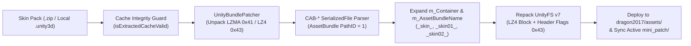

<div align="center">

# ⚡ Willy LibTool (`Android-LibTool-New`)

**Advanced Android Shizuku Asset Injector, UnityFS v7 Binary Patcher & Native C++17 IL2CPP Reverse Engineering Suite**

[](https://developer.android.com/ndk)
[-007EC6?style=for-the-badge&logo=android&logoColor=white)](https://developer.android.com)
[](https://shizuku.rikka.app/)
[](#%EF%B8%8F-unityfs-v7-binary-patcher-architecture)
[-2EA44F?style=for-the-badge)](#)
[](#)

---

**No Root Required (Shizuku Mode)** • **40+ MLBB Collector/Legend Skins** • **2X–5X Drone View** • **Real 165 FPS + ROG 8 Pro Spoof** • **Stealth Floating Overlay** • **IL2CPP Live Inspector**

</div>

---

## 📖 Overview

**Willy LibTool (`Android-LibTool-New`)** is a dual-layer Android modding and reverse-engineering toolkit combining:

1. **Shizuku Privileged Asset & UnityFS Engine (`com.android.support.shizuku`)**: Directly reads, patches, and synchronizes `UnityFS` (`.unity3d`) bundles inside `/sdcard/Android/data/com.mobile.legends/files/dragon2017/assets/` and active `mini_patch/` directories without requiring root access.
2. **Native C++17 IL2CPP & ImGui Instrumentation (`libTool.so`)**: Provides a high-performance OpenGL ES 3 Dear ImGui overlay, dynamic IL2CPP metadata reflection, live method invocation, AOB wildcard pattern scanning, and inline hooking via **Dobby**, **Frida Gum**, and **AsmJit**.

---

## ✨ Key Features

### 🎨 1. MLBB 40+ Premium Skin Unlocker & On-Device `UnityFS` Patcher
- **True `m_Container` & `m_AssetBundleName` Binary Remapping**: Powered by [`UnityBundlePatcher.java`](app/src/main/java/com/android/support/shizuku/UnityBundlePatcher.java), which unpacks `LZMA` (`0x41`) and `LZ4`/`LZ4HC` (`0x42`/`0x43`) `UnityFS` v7 bundles on-device, parses the internal `CAB-*` `SerializedFile` (`AssetBundle` `PathID = 1`), injects `_skin_`, `_skin01_`, and `_skin02_` container path aliases, and repacks with `flags = 0x43`.
- **Zero "Bilog" (Fallback Sphere) Protection**:
  - Preserves base hero skeleton rigs (`hero_<codeName>.unity3d`) and base smooth meshes (`hero_<codeName>_skin.unity3d`).
  - Strictly separates `_shadow_high_add.unity3d` / `_shadow_add.unity3d` from `_high_add.unity3d` / `_add.unity3d` so shadow bundles never overwrite 3D hero meshes.
  - Validates downloaded caches via `isExtractedCacheValid()` and automatically purges/re-downloads any 0-byte or truncated `.unity3d` files.
- **`GameResAlternative.unity3d` Table Remapping**: Rewrites 4-byte little-endian `SkinID` entries inside `mulonggame_table_1` (`CAB-728f8b2bd4a2ebfb6b6f1ef7e4be6373`) so selecting **Default Skin** in Hero Pick renders the unlocked Collector/Legend/Collab 3D model, animations, skill VFX, portraits, and voice lines.
- **Active `mini_patch` Synchronization**: Automatically propagates patched `Art/`, `UI/`, `Audio/`, and `Document/` bundles across `files/mini_patch/` so modern MLBB patches (`v2.2.16.12322+`) never shadow injected assets.

### 🚁 2. Multi-Stage Drone View (2X / 3X / 4X / 5X + Custom FOV)
- Supports **2X (Low)**, **3X (Mid)**, **4X (High)**, **5X (Ultra)** presets, and **1.0x–6.0x Custom Slider** scaling.
- Patches both classic and modern battlefield maps (`Cab-PvpMap011_add`, `Cab-PvpMap012_add`, `PVP_015_add`, `PVP_016_add`, `PVP_022_add`, `PVP_039_add`, `SceneCameraConfig`, `CameraHeight`) across both `dragon2017/assets/Art/android/` and active `mini_patch/` directories.
- 1-Tap **Restore Stock Camera** from verified backups.

### 🚀 3. Real 165 FPS Unlocker & ASUS ROG Phone 8 Pro Spoofer
- Unlocks **Ultra / Extreme (90 / 120 / 165 Hz)** frame rate tiers by injecting a patched `System Performance Table` spoofing **ASUS ROG Phone 8 Pro (`ASUS_AI2401_A` / `Adreno 750`)**.
- Locks Android display `peak_refresh_rate` and `min_refresh_rate` to `165.0 Hz` via Shizuku system settings and writes `HighFpsModeSee = 4` into `com.mobile.legends.v2.playerprefs.xml`.

### 🕵️ 4. Stealth Floating Mod Menu (`OverlayService`)
- **Draggable Floating Bubble & Compact HUD**: Accessible directly over the game without leaving your match.
- **Orientation-Aware Bounds Clamping**: Automatically clamps floating bubble and menu coordinates when rotating between Portrait (`MainActivity`) and Landscape (`MLBB`) so the overlay never goes off-screen.
- **Stealth Hide Mode (`🙈 Stealth`)**: Completely hides the floating bubble and menu from screen recording or screenshots; restore anytime with 1 tap from the notification shade (`👁️ Show Menu`).

### 🧠 5. Native C++17 Reverse Engineering Engine (`libTool.so`)
- **🔍 IL2CPP Inspector & Live Invoker**: Browse assemblies, namespaces, classes, fields, and methods at runtime and invoke methods live.
- **⚡ AOB Wildcard Sigscanner**: Fast signature scanner supporting `??` wildcards across executable memory ranges.
- **🔎 In-Game Memory Searcher**: Scan and filter `Dword`, `Float`, `Qword`, and `Hex` values dynamically.
- **🎯 Native ESP & Visual Canvas**: Hardware-accelerated OpenGL ES 3 primitives for boxes, lines, skeletons, and distance overlays.
- **🛡️ MemoryGuard & Hooking**: Built-in anti-tamper protection alongside **Dobby**, **Frida Gum**, and **AsmJit** hooking backends.

---

## 🏗️ UnityFS v7 Binary Patcher Architecture



---

## 🦸 Supported 40+ Hero Skins Matrix

| Role | Hero | Injected Skin | Internal Prefix | Target ID |
| :--- | :--- | :--- | :--- | :---: |
| **Jungle** | **Fanny** | Blade of Kibou *(Aspirants)* | `hero_fanny` | `08` |
| **Jungle** | **Ling** | Seraphic Scourge *(Collector)* | `hero_pofa` | `04` |
| **Jungle** | **Gusion** | Dimension Crusher *(11.11)* | `hero_Gusin` | `07` |
| **Jungle** | **Hayabusa** | Shura *(11.11)* | `hero_ninja` | `05` |
| **Jungle** | **Lancelot** | Bren Esports *(Champion)* | `hero_lancelot` | `04` |
| **Jungle** | **Nolan** | The Navigator | `hero_NolanOsborne` | `03` |
| **Jungle** | **Aamon** | Noble Crest *(Elite)* | `hero_Aamon` | `03` |
| **Jungle** | **Saber** | Codename: Storm *(Legend)* | `hero_assassin` | `04` |
| **Jungle** | **Julian** | Kurapika *(Hunter × Hunter)* | `hero_julian` | `03` |
| **Mage** | **Kagura** | Water Lily *(Annual Starlight)* | `hero_kagura` | `06` |
| **Mage** | **Lunox** | Eyes of Eternity *(Epic)* | `hero_balancemagic` | `06` |
| **Mage** | **Harith** | EVOS Legends *(Champion)* | `hero_moshushi` | `04` |
| **Mage** | **Cecilion** | Crimson Wings *(Collector)* | `hero_couplemage` | `04` |
| **Mage** | **Xavier** | Satoru Gojo *(Jujutsu Kaisen)* | `hero_xavier` | `03` |
| **Mage** | **Nana** | Aqua Pura *(Collector)* | `hero_nana` | `08` |
| **Mage** | **Chang'e** | Cyber Cherub *(Aspirants)* | `hero_change` | `05` |
| **Mage** | **Vexana** | The Sun Empress *(Collector)* | `hero_Vexana` | `05` |
| **Tank** | **Tigreal** | Lightborn Defender | `hero_warrior` | `05` |
| **Tank** | **Franco** | King of Hell *(Legend)* | `hero_franco` | `08` |
| **Tank** | **Khufra** | Volcanic Overlord *(Collector)* | `hero_munaiyi` | `04` |
| **Tank** | **Atlas** | Space Mech *(Collector)* | `hero_atelasi` | `03` |
| **Tank** | **Johnson** | Starblazer *(Legend)* | `hero_johnson` | `05` |
| **Tank** | **Gatotkaca** | Sentinel *(Epic)* | `hero_gatot` | `03` |
| **Tank** | **Akai** | Kung Fu Panda *(Po)* | `hero_xiongmao` | `07` |
| **Marksman** | **Granger** | Starfall Knight *(Legend)* | `hero_mike` | `12` |
| **Marksman** | **Layla** | Miss Hikari *(Aspirants)* | `hero_shooter` | `12` |
| **Marksman** | **Moskov** | Doom Incarnate *(Abyss)* | `hero_Moskov` | `10` |
| **Marksman** | **Claude** | Blazing Trace | `hero_claude` | `08` |
| **Marksman** | **Miya** | Atomic Pop | `hero_gongjianshou` | `14` |
| **Marksman** | **Karrie** | Gill-Girl *(Annual Starlight)* | `hero_feilun` | `11` |
| **Marksman** | **Beatrix** | Stellar Brilliance *(M4 Prime)* | `hero_chargingshooter` | `06` |
| **Marksman** | **Brody** | Apex Hunter *(Collector)* | `hero_feiden` | `04` |
| **Marksman** | **Wanwan** | Pixel Blast *(Collector)* | `hero_wanwan` | `04` |
| **Marksman** | **Lesley** | Hawk-eyed Sniper *(Annual Star)* | `hero_sniper` | `05` |
| **Support** | **Angela** | Avatar of Time *(Annual Star)* | `hero_angela` | `05` |
| **Support** | **Estes** | Blacklist International *(M3)* | `hero_angel` | `05` |
| **Support** | **Diggie** | Fairytaler *(Epic)* | `hero_digger` | `04` |
| **Support** | **Floryn** | Cinnamoroll *(Sanrio)* | `hero_Idun` | `02` |
| **Support** | **Mathilda** | Dream Groove *(MPL)* | `hero_madierda` | `03` |
| **Support** | **Rafaela** | S.A.B.E.R. Savior / Lunar Fest | `hero_lanbote` | `03` |
| **Fighter** | **Chou** | Iori Yagami *(KOF)* | `hero_kongfu` | `13` |
| **Fighter** | **Yu Zhong** | Cosmic Dragon *(Collector)* | `hero_BlackDragon` | `05` |
| **Fighter** | **Paquito** | Ryu *(Street Fighter)* | `hero_pakuite` | `04` |
| **Fighter** | **Ruby** | Mecha Maiden *(Aspirants)* | `hero_xiaohongmao` | `07` |
| **Fighter** | **Dyrroth** | Orochi Chris / SF | `hero_diyasi` | `05` |
| **Fighter** | **Alpha** | General Void *(Abyss)* | `hero_entropy` | `05` |
| **Fighter** | **Alucard** | Obsidian Blade *(Legend)* | `hero_alucard` | `05` |

---

## 📂 Project Structure

```text
Android-LibTool-New/
├── app/
│   ├── src/main/
│   │   ├── AndroidManifest.xml
│   │   ├── assets/mlbb_drone/          # Bundled Drone View (2X-5X) & GameResAlternative.unity3d
│   │   ├── java/com/android/support/
│   │   │   ├── MainActivity.java       # Main Dashboard UI (Shizuku status, Drone, 165 FPS, Skins)
│   │   │   ├── OverlayService.java     # Draggable Floating Bubble & Stealth Mod Menu Service
│   │   │   ├── Menu.java               # Native JNI ImGui Menu Bridge
│   │   │   └── shizuku/
│   │   │       ├── MlbbModInjector.java    # Core MLBB Drone, 165 FPS, & 40+ Hero Skin Injector
│   │   │       ├── UnityBundlePatcher.java # Pure-Java UnityFS v7 LZMA/LZ4 Parser & Container Remapper
│   │   │       └── ShizukuShell.java       # Privileged binder shell execution via Shizuku
│   │   ├── jni/                        # Core C++17 Native Engine (libTool.so)
│   │   │   ├── Main.cpp                # JNI Entrypoint & lifecycle
│   │   │   ├── asmjit/                 # Runtime JIT assembler
│   │   │   ├── Dobby/                  # Native inline hook framework
│   │   │   ├── Frida/                  # Frida Gum interceptor runtime
│   │   │   ├── Il2cpp/                 # IL2CPP runtime resolver & reflection bindings
│   │   │   ├── imgui/                  # Dear ImGui OpenGL ES 3 renderer
│   │   │   ├── Menu/                   # Native ImGui tabs & theme styling
│   │   │   └── Tool/                   # Advanced Reverse Engineering Modules
│   │   │       ├── AOBScanner.cpp      # Wildcard signature scanner
│   │   │       ├── ESP.cpp             # Overlay drawing primitives
│   │   │       ├── InvokerTab.cpp      # Live IL2CPP method invoker
│   │   │       ├── MemoryGuard.cpp     # Anti-tamper & memory integrity guard
│   │   │       ├── MemorySearcherTab.cpp # Multi-type in-game memory scanner
│   │   │       └── Stealth.cpp         # Stealth & hook protection
│   │   └── res/                        # Layouts (activity_main.xml, floating_menu.xml) & drawables
│   └── build.gradle
├── tools/
│   ├── build_gameres_alternative.py    # Offline builder & verifier for GameResAlternative.unity3d
│   └── test_unity_bundle_patcher.py    # Host JVM unit test for UnityBundlePatcher
├── docs/superpowers/plans/             # Engineering architecture & root-cause analysis plans
├── build.gradle
└── README.md
```

---

## 🚀 Getting Started & Usage Guide

### 1. Shizuku Setup (On Your Android Device)
1. Install and open **Shizuku** (`moe.shizuku.privileged.api`), then start the Shizuku service via **Wireless Debugging** (Android 11+) or **ADB**.
2. Install and launch **Willy LibTool** (`app-debug.apk`).
3. Tap **Grant / Request Shizuku Permission** when prompted (`Status: Shizuku Active ✅`).

### 2. Injecting Skins, Drone View & 165 FPS
1. Tap **Launch Floating Menu** (or configure directly from the Main Dashboard).
2. **To Unlock Hero Skins**:
   - Tap any individual Hero button (e.g., **Fanny — Aspirants**, **Ling — Collector**, **Gusion — 11.11**) or unlock an entire role (**Jungle**, **Mage**, **Tank**, **MM**, **Support**, **Fighter**).
   - Wait for the download & `UnityBundlePatcher` progress bar to complete (`✅ Injected!`).
   - In **Mobile Legends Hero Pick**, select the **DEFAULT Skin** — your game will render the full Collector/Legend 3D model, custom animations, skill effects, and loading screen portrait.
3. **To Restore Stock Files**:
   - Tap **Restore All Hero Skins** or **Reset Camera** at any time to restore genuine stock assets from backup.

---

## 🛠️ Building & Verification

### Prerequisites
- **Android SDK** (`compileSdk 34`, `buildToolsVersion 34.0.0`)
- **Android NDK** (`27.0.12077973` or compatible)
- **Java JDK** (`17` or `21`)
- **Python 3** + `lz4` *(optional, for running bundle verification scripts)*

### Verify `UnityBundlePatcher` & `GameResAlternative.unity3d`
```bash
python3 tools/test_unity_bundle_patcher.py
python3 tools/build_gameres_alternative.py --verify
```

### Compile Debug APK
```bash
./gradlew assembleDebug
```
The compiled APK will be generated at:
```text
app/build/outputs/apk/debug/app-debug.apk
```

---

## 📜 Disclaimer & License

This project is developed strictly for **educational, asset format research, and reverse-engineering study purposes**. All game trademarks, hero names, and assets belong to their respective owners. Distributed under the project `LICENSE`.
