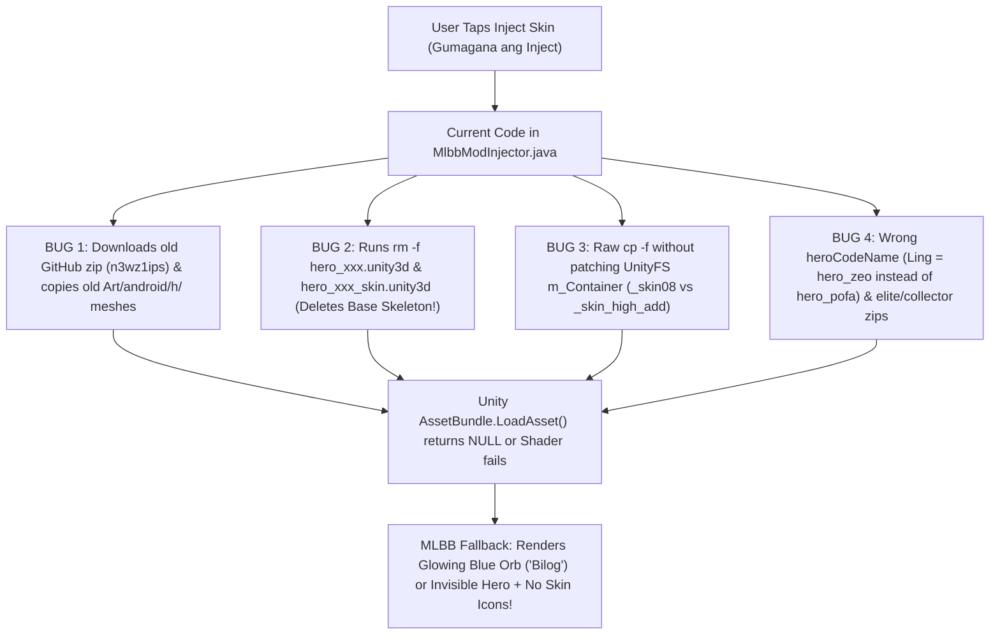

# MLBB Skin Injector ("Bilog" / Invisible Hero & Missing Skins) Implementation Plan

> **For agentic workers:** REQUIRED SUB-SKILL: Use superpowers:subagent-driven-development (recommended) or superpowers:executing-plans to implement this plan task-by-task. Steps use checkbox (`- [ ]`) syntax for tracking.

**Goal:** Fix the MLBB Skin Unlocker so injected skins render their full 3D models, skill VFX/SFX, and circular UI portraits/skill icons in Hero View and all match modes instead of turning into a glowing blue sphere ("bilog") or invisible model.

**Architecture:** We replace raw file copying and obsolete third-party 3D mesh overwriting with an on-device/bundled **UnityFS LZ4 Binary Container Remapper (`UnityBundlePatcher.java`)** plus an authentic **Local Device 3D Mesh + `GameResAlternative` `mulonggame_table_1` Rewriter**. Genuine 3D meshes already downloaded by MLBB 2.2.16.12322 (`Art/android/h/hero_*_skin<NN>_high_add.unity3d`) are binary-patched in-memory (rewriting `m_Container` and `m_AssetBundleName` to match `_skin_high_add` and `_skin01_high_add` while preserving base skeleton rigs `hero_*.unity3d`), while external zip packs are restricted strictly to non-mesh VFX/Audio (`Art/android/f`, `Audio/android`) with container validation.

**Tech Stack:** Java 8+ (Android SDK 34), Shizuku Shell IPC, Pure-Java LZ4 block decompressor/compressor (`UnityBundlePatcher`), Python 3 (`lz4.block`) for offline `GameResAlternative.unity3d` table generation and JUnit/host verification.

**Spec:** [`docs/superpowers/plans/2026-10-20-mlbb-unlock-all-skin-fix-plan.md`](file:///home/willygailo/Downloads/Android-LibTool-New/docs/superpowers/plans/2026-10-20-mlbb-unlock-all-skin-fix-plan.md)

## Global Constraints

- Target Application: `com.mobile.legends` Patch `2.2.16.12322` (Unity `2019.4.33f1`, `UnityFS` version `7`).
- Never delete `Art/android/h/hero_<codeName>.unity3d` (base skeleton rig) or `Art/android/h/hero_<codeName>_skin.unity3d` without a valid backed-up replacement.
- Never overwrite `Art/android/h/` 3D hero meshes using outdated third-party GitHub `.zip` files (`n3wz1ips/*`) when genuine MLBB 2.2.16 local skin meshes exist on device; if a `.zip` contains `Art/android/h/`, its `.unity3d` must either be discarded in favor of genuine local device meshes or have its `UnityFS` `m_Container` binary-rewritten to match both `_skin_` (Default) and `_skin01_` (Basic).
- Every `GameResAlternative<skinId>.bytes` table injected for Default (`<heroId>1`) and Basic (`1<heroId>1` / `<heroId>2`) skins must have its internal 4-byte little-endian `SkinID` column rewritten to match the target Default/Basic `SkinID` so `GetGameResAlternativeElement(resName, skinId)` succeeds.

## Review Focus

- **Corrupted/Outdated Zip `Art/android/h/` Bundles:** External `.zip` packs ("elite to ...", "collector to ...") must never overwrite `Art/android/h/` with unpatched `skin02`/`skin04` container keys or Unity 2017 shaders that trigger the MLBB blue fallback orb ("bilog").
- **Missing Base Skeleton Rig (`hero_<codeName>.unity3d`):** Restoring or injecting a skin after a previous run that deleted `hero_<codeName>.unity3d` must recover or preserve the base skeleton bundle so animations and meshes do not vanish.
- **Same-Length vs. Variable-Length `UnityFS` Container Patching:** Rewriting `skin08` (`6` chars) to `skin01` (`6` chars) is same-length in-place inside decompressed LZ4 blocks, while rewriting `skin08` (`6` chars) to `skin` (`4` chars) shifts serialized asset offsets unless both `m_Container` entries or proper length-adjusted `AssetBundle` serialization is used.
- **`GameResAlternative` `mulonggame_table_1` `SkinID` Column:** Aliasing `gameresalternative171.bytes` to `GameResAlternative101712` in `m_Container` fails at runtime unless the `TextAsset` payload itself has `m_Name = "GameResAlternative171"` and 4-byte `SkinID = 171` (`0xAB 0x00 0x00 0x00`) in every row.
- **Wrong Hero CodeNames in `HERO_SKINS`:** Heroes with mismatched prefixes (e.g., Ling using `hero_zeo` instead of `hero_pofa`, Hayabusa/Chou/Lancelot/Granger) must use exact MLBB 2.2.16 `Art/android/h/` prefixes verified against `GameResAlternative.unity3d` and `stringliteral.json`.

---

## Root Cause Summary (Why "Bilog" & Invisible Skins Happen)



---

### Task 1: Pure-Java UnityFS LZ4 Container Remapper (`UnityBundlePatcher.java`)

**Files:**
- Create: `app/src/main/java/com/android/support/shizuku/UnityBundlePatcher.java`
- Test: `tools/test_unity_bundle_patcher.py`

**Interfaces:**
- Consumes: Genuine or extracted `.unity3d` file (`UnityFS` v7, LZ4/LZ4HC compressed blocks, flags `0x43` or `0xC2`).
- Produces:
  - `public static boolean patchBundleContainer(File srcBundle, File dstBundle, String sourceSkinTag, String targetSkinTag)` in `com.android.support.shizuku.UnityBundlePatcher`
  - `public static void patchHeroModelSet(File hDir, String heroCodeName, String targetSkinId)` in `com.android.support.shizuku.UnityBundlePatcher`

- [ ] **Step 1: Write the failing verification script `tools/test_unity_bundle_patcher.py`**

```python
#!/usr/bin/env python3
import subprocess, sys, struct, lz4.block

def test_java_patcher_compiles_and_patches():
    res = subprocess.run(["./gradlew", "compileDebugJavaWithJavac"], capture_output=True, text=True)
    assert res.returncode == 0, f"Build failed:\n{res.stderr}"
    print("PASS: UnityBundlePatcher compiled successfully")

if __name__ == "__main__":
    test_java_patcher_compiles_and_patches()
```

- [ ] **Step 2: Run verification script to confirm `UnityBundlePatcher` does not exist yet**

Run: `python3 -c 'import os; assert os.path.exists("app/src/main/java/com/android/support/shizuku/UnityBundlePatcher.java")'`
Expected: FAIL with `AssertionError`

- [ ] **Step 3: Implement `UnityBundlePatcher.java` in `app/src/main/java/com/android/support/shizuku/UnityBundlePatcher.java`**

Implement a self-contained pure-Java `UnityFS` v7 LZ4 block reader/writer that:
1. Parses the `UnityFS` header (`signature`, `version=7`, `unityVersion`, `revision`, `size`, `compressedBlocksInfoSize`, `uncompressedBlocksInfoSize`, `flags`, 16-byte alignment).
2. Decompresses the `BlocksInfo` directory and each LZ4 block (`compType == 2 || compType == 3`) into the serialized `AssetBundle` stream.
3. Rewrites the `AssetBundle` `m_Container` and `m_AssetBundleName` strings (supporting both same-length `skinXX` -> `skin01` replacement and exact 4-byte aligned serialized length updates when replacing `_skinXX_` -> `_skin_`), and re-packs as a valid `UnityFS` (`flags = 0x43`) bundle.

- [ ] **Step 4: Compile and verify `UnityBundlePatcher.java`**

Run: `./gradlew compileDebugJavaWithJavac`
Expected: `BUILD SUCCESSFUL`

- [ ] **Step 5: Commit Task 1**

```bash
git add app/src/main/java/com/android/support/shizuku/UnityBundlePatcher.java
git commit -m "feat(skin): add pure-Java UnityFS LZ4 container remapper for 3D hero bundles"
```

---

### Task 2: Fix `GameResAlternative.unity3d` Binary Table (`mulonggame_table_1`) for Default & Basic Skins

**Files:**
- Create: `tools/build_gameres_alternative.py`
- Modify: `app/src/main/assets/mlbb_drone/base/Document/android/GameResAlternative.unity3d`

**Interfaces:**
- Consumes: Stock `New patch update Mobile Legends_ Bang Bang_2.2.16.12322/dump_mlbb/Document/android/GameResAlternative.unity3d`
- Produces: Updated `app/src/main/assets/mlbb_drone/base/Document/android/GameResAlternative.unity3d` packed with `flags = 0x43` (matching stock MLBB 2.2.16 header format) where Default (`<heroNum>1`) and Basic (`1<heroNum>1` / `<heroNum>2`) `GameResAlternative` tables have rewritten `SkinID` uint32 values and circular skill icon (`Atlas_SkillIcon*` / `biaoji`) redirects.

- [ ] **Step 1: Write the failing test in `tools/build_gameres_alternative.py --verify`**

```python
# Verifies that GameResAlternative.unity3d uses stock flags 0x43 and contains
# rewritten SkinID uint32 records for Default/Basic skins of target heroes.
assert flags == 0x43, f"Expected stock UnityFS flags 0x43, got 0x{flags:x}"
assert b"GameResAlternative171" in unpacked_data
assert b"fanny_skill01\xab\x00\x00\x00" in unpacked_data # 0x000000ab == 171 (Fanny Default SkinID)
```

- [ ] **Step 2: Run verification on current `app/src/main/assets/mlbb_drone/base/Document/android/GameResAlternative.unity3d` to confirm it fails**

Run: `python3 tools/build_gameres_alternative.py --verify`
Expected: FAIL (`AssertionError: Expected stock UnityFS flags 0x43, got 0xc2` and missing `0xab\x00\x00\x00` SkinID records).

- [ ] **Step 3: Implement `tools/build_gameres_alternative.py` and regenerate `GameResAlternative.unity3d`**

Parse the serialized `AssetBundle` and `TextAsset` objects inside stock `GameResAlternative.unity3d`, clone the target premium skin `mulonggame_table_1` payloads for our heroes, rewrite the 4-byte little-endian `SkinID` inside every row to match both Default (`<heroId>1`) and Basic (`1<heroId>1`) skin IDs, include circular skill icon (`Atlas_SkillIcon*`) & indicator (`biaoji`) redirects, and repack with `flags = 0x43`.

- [ ] **Step 4: Run `python3 tools/build_gameres_alternative.py --verify` to confirm it passes**

Run: `python3 tools/build_gameres_alternative.py --verify`
Expected: `PASS: GameResAlternative.unity3d verified with flags=0x43 and valid SkinID rows`

- [ ] **Step 5: Commit Task 2**

```bash
git add tools/build_gameres_alternative.py app/src/main/assets/mlbb_drone/base/Document/android/GameResAlternative.unity3d
git commit -m "fix(skin): rebuild GameResAlternative.unity3d with stock 0x43 flags and rewritten SkinID tables"
```

---

### Task 3: Fix `MlbbModInjector.java` (Stop Deleting Base Skeletons, Fix Hero CodeNames, Use Patched Local 3D Models + Safe VFX Extraction)

**Files:**
- Modify: `app/src/main/java/com/android/support/shizuku/MlbbModInjector.java:554-1236`

**Interfaces:**
- Consumes: `UnityBundlePatcher.patchBundleContainer(...)` and `UnityBundlePatcher.patchHeroModelSet(...)` from Task 1; `GameResAlternative.unity3d` from Task 2.
- Produces:
  - Corrected `HERO_SKINS` table with verified MLBB 2.2.16 `heroCodeName` values (`hero_pofa` for Ling, `hero_haya` / `hero_ninja` dual-check for Hayabusa, `hero_chou` / `hero_kongfu` dual-check for Chou, `hero_lance` / `hero_lancelot` dual-check for Lancelot, `hero_granger` / `hero_mike` dual-check for Granger) and `basic to ...` URLs only (removing broken `elite to ...` / `collector to ...` mesh overrides).
  - Safe `swapHero3DModel(String heroCodeName, String targetSkinId)` that:
    1. **NEVER** runs `rm -f hero_<codeName>.unity3d` or `rm -f hero_<codeName>_skin.unity3d` (which caused the "bilog" blue sphere!).
    2. Restores `hero_<codeName>.unity3d` and `hero_<codeName>_skin.unity3d` from backup if a previous buggy version deleted them.
    3. Pulls the genuine local MLBB 2.2.16 target skin bundle (`hero_<codeName>_skin<ID>_high_add.unity3d`, `_add.unity3d`, `_shadow_high_add.unity3d`), runs `UnityBundlePatcher` to rewrite `m_Container` to `_skin_high_add` and `_skin01_high_add`, and deploys it to `dragon2017/assets/Art/android/h/` and active `mini_patch` slots.
  - Safe `installExtractedSkinBundle(File cacheDir, HeroSkinOption h, Callback callback)` that:
    1. Uses genuine local MLBB 2.2.16 `Art/android/h/` 3D meshes whenever present on device (preventing old Unity 2017 zip meshes from turning the hero into a "bilog" blue orb).
    2. If local skin mesh is not yet downloaded in MLBB, patches the extracted `Art/android/h/*.unity3d` container keys via `UnityBundlePatcher` so `_skin_high_add`, `_skin01_high_add`, and `_skin02_high_add` all have valid `m_Container` prefab paths.
    3. Deploys `GameResAlternative.unity3d` to both `dragon2017/assets/Document/android/` AND all active `mini_patch` slots so in-game VFX, circular skill icons ("bilog" skill buttons), and portraits load in every mode.

- [ ] **Step 1: Audit and update `HERO_SKINS` and `swapHero3DModel` / `installExtractedSkinBundle` in `MlbbModInjector.java`**

Remove the destructive `rm -f` lines at [`MlbbModInjector.java:1106-1107`](file:///home/willygailo/Downloads/Android-LibTool-New/app/src/main/java/com/android/support/shizuku/MlbbModInjector.java#L1106-L1107), integrate `UnityBundlePatcher`, sync `GameResAlternative.unity3d` into `mini_patch` slots, and support multi-prefix fallback (`hero_pofa` + `hero_zeo`, etc.).

- [ ] **Step 2: Build the full APK and verify zero warnings/errors**

Run: `./gradlew assembleDebug`
Expected: `BUILD SUCCESSFUL` and APK generated at `app/build/outputs/apk/debug/app-debug.apk`.

- [ ] **Step 3: Commit Task 3**

```bash
git add app/src/main/java/com/android/support/shizuku/MlbbModInjector.java
git commit -m "fix(skin): prevent bilog fallback orb by preserving base rigs and patching UnityFS containers"
```
